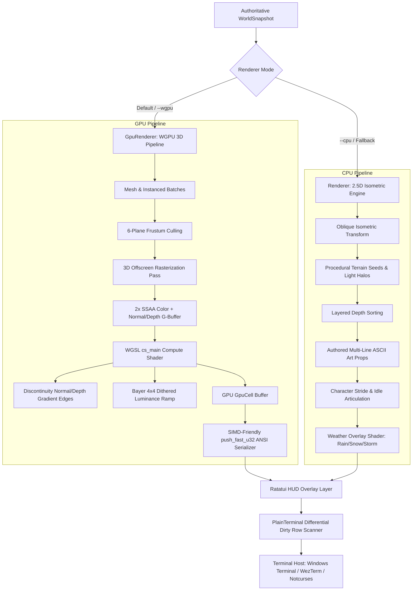

# Comprehensive Architecture & Engine Explainer Guide

> **Target Audience**: External AI agents, systems architects, and remote contributors onboarding to the `ascii-mmorpg` codebase.
> **Note on File Access**: This document is fully **self-contained**. It embeds all critical protocol structs, network framing codecs, WGSL shaders, collision algorithms, animation logic, and ASCII asset frames. You do not need access to local repository files to understand the system.
> **Current Version**: Alpha 0.1.0 (`PROTOCOL_VERSION: 2`)

---

## 1. Executive Summary & Game Vision

`ascii-mmorpg` is a high-performance, dark fantasy multiplayer role-playing game built in modern, stable Rust (`edition 2021`). Unlike traditional text-based MUDs or simplistic rogue-likes, `ascii-mmorpg` bridges the gap between retro terminal interfaces and modern real-time 3D graphics engines. 

The game presents an atmospheric, high-fidelity world—featuring ancient mossy ruins, colonnade pillars, towering pine forests with buttressed roots, dynamic torchlit fortresses, and turbulent weather (rain, snow, storm)—rendered entirely through standard ANSI truecolor escape sequences, Unicode box-drawing characters, and CP437 glyphs in standard terminal emulators (Windows Terminal, WezTerm, ConHost, Alacritty, Kitty).

### Key Architectural Highlights
* **Authoritative Client-Server Separation**: Deterministic server simulation running over length-prefixed Postcard binary streams. The server owns positions, ticks, stats, and combat resolution; clients strictly handle prediction, rendering, animation, and presentation.
* **Dual Rendering Pipeline**:
  1. **Hardware-Accelerated WGPU 3D Engine (`client/src/gpu`)**: Full 3D polygon rasterization, GPU-instanced props/particles, 8 dynamic point lights, frustum culling, 2x Super-Sampled Anti-Aliasing (SSAA), and WGSL compute shader discontinuity edge detection ($>170\text{ FPS}$).
  2. **Procedural ANSI CPU Engine (`client/src/renderer.rs`)**: 2.5D oblique isometric rasterizer with ray/depth veils, procedural surface seed texturing, multi-line authored ASCII assets, and post-processing weather passes.
* **Movement-Aware Articulation**: Eliminates the "marching in place" artifact common in retro games; characters feature stationary stance postures with firmly planted boots when idle, and articulate smooth leg swings only during active displacement.
* **Differential Terminal Streaming**: Custom dirty row-level scanner with continuous CRLF burst streaming, preventing Windows ConPTY tearing and achieving smooth, flicker-free 60+ FPS in terminal hosts.
* **Ratatui Dark Fantasy HUD**: TrueColor fractional health gauges, colorized scrolling combat event logs, nearby hostile radar lock, and responsive status headers.

---

## 2. Workspace & Crate Structure

The repository is structured as a Cargo workspace with five specialized crates:

```
ascii-mmorpg/
├── crates/
│   ├── shared/                # Core protocol, network codec, deterministic combat & spatial collisions
│   │   ├── src/collision.rs   # 2D/3D AABB bounding volumes & sliding physics
│   │   ├── src/combat.rs      # Deterministic melee resolution & range calculation
│   │   ├── src/protocol.rs    # Wire commands, snapshots, and entity representations
│   │   └── src/codec.rs       # Length-prefixed Postcard serialization
│   └── libnotcurses-sys/      # Vendored low-level C bindings for Notcurses (optional feature)
├── client/                    # Terminal client, dual renderers, HUD, input loop
│   ├── src/gpu/               # WGPU 3D hardware pipeline (Path C)
│   │   ├── pipeline.rs        # Render & compute pipelines, G-buffers, bind groups
│   │   ├── mesh.rs            # 3D procedural primitives, humanoids, monsters, terrain
│   │   ├── shaders.rs         # WGSL rasterization & ASCII post-process compute shaders
│   │   ├── renderer.rs        # High-level GpuRenderer coordinator & batch processor
│   │   └── obj.rs             # Wavefront OBJ model parser
│   ├── src/renderer.rs        # Procedural CPU ANSI renderer (Path A/B)
│   ├── src/ui.rs              # Ratatui Dark Fantasy HUD overlay
│   ├── src/lib.rs             # PlainTerminal differential blitter & SceneRenderer traits
│   ├── src/main.rs            # Real-time game loop, raw input handler, CLI flags
│   └── src/assets.rs          # Compile-time embedded ASCII asset library
├── server/                    # Authoritative game server, fixed-tick loop, TCP server
├── bot/                       # Headless stress-test client and network simulation bots
├── tools/                     # Content schema validation & offline integrity checkers
├── assets/ascii/              # Multi-frame authored ASCII art (.txt files)
├── content/                   # RON-formatted game data (spells, items, loot tables, zones)
└── docs/                      # Comprehensive technical documentation & Single Source of Truth
```

---

## 3. Network Protocol & Wire Serialization

The network protocol is designed for minimal wire footprint, low latency, and deterministic execution. It utilizes **Postcard** (a compact binary format) wrapped in a **4-byte Little-Endian length prefix**.

```
+--------------------------------+------------------------------------------------+
|  4-Byte LE Length (u32, bytes) |         Postcard Serialized Payload            |
+--------------------------------+------------------------------------------------+
```

### 3.1 Wire Codec Implementation (`crates/shared/src/codec.rs`)

The entire framing and parsing logic is implemented as follows:

```rust
use serde::{de::DeserializeOwned, Serialize};
use std::io::{self, Read, Write};

pub const MAX_FRAME_SIZE: usize = 1024 * 1024; // 1 MB limit prevents packet floods

#[derive(Debug)]
pub enum CodecError {
    Io(io::Error),
    InvalidLength(u32),
    Truncated { expected: usize, actual: usize },
    Postcard(postcard::Error),
}

pub fn encode_frame<T: Serialize>(value: &T) -> Result<Vec<u8>, CodecError> {
    let payload = postcard::to_allocvec(value)?;
    if payload.is_empty() || payload.len() > MAX_FRAME_SIZE {
        return Err(CodecError::InvalidLength(payload.len() as u32));
    }
    let length = payload.len() as u32;
    let mut frame = Vec::with_capacity(4 + payload.len());
    frame.extend_from_slice(&length.to_le_bytes());
    frame.extend_from_slice(&payload);
    Ok(frame)
}

pub fn decode_frame<T: DeserializeOwned>(bytes: &[u8]) -> Result<(T, usize), CodecError> {
    if bytes.len() < 4 {
        return Err(CodecError::Truncated { expected: 4, actual: bytes.len() });
    }
    let length = u32::from_le_bytes([bytes[0], bytes[1], bytes[2], bytes[3]]) as usize;
    if length == 0 || length > MAX_FRAME_SIZE {
        return Err(CodecError::InvalidLength(length as u32));
    }
    let end = 4 + length;
    if bytes.len() < end {
        return Err(CodecError::Truncated { expected: end, actual: bytes.len() });
    }
    Ok((postcard::from_bytes(&bytes[4..end])?, end))
}
```

### 3.2 Protocol Data Structures (`crates/shared/src/protocol.rs`)

```rust
use serde::{Deserialize, Serialize};

pub const PROTOCOL_VERSION: u16 = 2;
pub type Tick = u64;
pub type EntityId = u64;

#[derive(Clone, Copy, Debug, Default, Deserialize, Eq, PartialEq, Serialize)]
pub struct Point {
    pub x: i16,
    pub y: i16,
}

#[derive(Clone, Copy, Debug, Deserialize, Eq, PartialEq, Serialize)]
pub enum Direction {
    North, South, East, West,
    NorthEast, NorthWest, SouthEast, SouthWest,
}

impl Direction {
    pub const fn delta(self) -> (i16, i16) {
        match self {
            Self::North     => (0, -1),
            Self::South     => (0, 1),
            Self::East      => (1, 0),
            Self::West      => (-1, 0),
            Self::NorthEast => (1, -1),
            Self::NorthWest => (-1, -1),
            Self::SouthEast => (1, 1),
            Self::SouthWest => (-1, 1),
        }
    }
}

#[derive(Clone, Debug, Deserialize, Eq, PartialEq, Serialize)]
pub enum Command {
    Move(Direction),
    Attack,
    Rest,
    Say(String),
    Cast { spell: String, target: EntityId },
}

#[derive(Clone, Debug, Deserialize, Eq, PartialEq, Serialize)]
pub struct ClientCommand {
    pub protocol_version: u16,
    pub client_tick: Tick,
    pub command: Command,
}

#[derive(Clone, Debug, Deserialize, Eq, PartialEq, Serialize)]
pub struct Stats {
    pub max_hp: i32,
    pub hp: i32,
    pub attack: i32,
    pub defense: i32,
    pub luck: u8,
}

#[derive(Clone, Debug, Deserialize, Eq, PartialEq, Serialize)]
pub enum EntityKind {
    Player,
    Monster,
    Npc,
    Item,
}

#[derive(Clone, Debug, Deserialize, Eq, PartialEq, Serialize)]
pub struct ActorSnapshot {
    pub id: EntityId,
    pub name: String,
    pub kind: EntityKind,
    pub position: Point,
    pub stats: Stats,
    pub glyph: char,
}

#[derive(Clone, Debug, Deserialize, Eq, PartialEq, Serialize)]
pub struct WorldSnapshot {
    pub tick: Tick,
    pub player: ActorSnapshot,
    pub entities: Vec<ActorSnapshot>,
    pub messages: Vec<String>,
}

#[derive(Clone, Debug, Deserialize, Eq, PartialEq, Serialize)]
pub enum ServerEvent {
    Welcome { protocol_version: u16, player_id: EntityId },
    Snapshot(WorldSnapshot),
    Combat { attacker: EntityId, defender: EntityId, damage: i32, defeated: bool },
    Loot { owner: EntityId, drops: Vec<LootDrop> },
    Notice(String),
    Error(String),
}
```

---

## 4. Rendering Pipeline Architecture

The client implements the `SceneRenderer` trait, enabling seamless switching between rendering backends at launch:



### 4.1 The WGPU 3D Hardware Pipeline (`client/src/gpu`)

* **2x Super-Sampled Rasterization**: The 3D scene renders offscreen at $2\times$ the character cell resolution ($(\text{width} \times 2, \text{height} \times 2)$).
  * `color_tex` (`Rgba8Unorm`): Base color, Blinn-Phong lighting, and specular highlights.
  * `normal_depth_tex` (`Rgba32Float`): World-space normals $(N_x, N_y, N_z)$ and linear clip depth $(W)$.
* **Vertex Wind Swaying**: Implemented in WGSL `vs_main`. Elevated foliage vertices oscillate laterally with time:

```wgsl
@vertex
fn vs_main(in: VertexInput, inst: InstanceInput) -> VertexOutput {
    var out: VertexOutput;
    let model = mat4x4<f32>(
        inst.model_col0, inst.model_col1,
        inst.model_col2, inst.model_col3,
    );
    var world_pos4 = model * vec4<f32>(in.position, 1.0);
    let mat_id = select(in.material_id, inst.instance_material.x, inst.instance_material.x >= 0.0);

    // Procedural wind sway for foliage (material_id == 3.0: pine needles, leaves, canopies)
    // Anchors tree base/ground while allowing elevated canopy cones and boughs to oscillate
    if (mat_id >= 2.8 && mat_id <= 3.2 && world_pos4.y > 0.8) {
        let wind_intensity = min((world_pos4.y - 0.8) * 0.045, 0.18);
        let sway = sin(camera.time * 2.4 + world_pos4.x * 0.65 + world_pos4.z * 0.45) * wind_intensity;
        world_pos4.x += sway;
        world_pos4.z += sway * 0.45;
    }

    out.world_pos = world_pos4.xyz;
    out.world_normal = normalize((model * vec4<f32>(in.normal, 0.0)).xyz);
    out.color = in.color * inst.instance_color;
    out.material_id = mat_id;
    out.roughness = select(in.roughness, inst.instance_material.y, inst.instance_material.y >= 0.0);
    out.clip_position = camera.view_proj * world_pos4;
    return out;
}
```

* **WGSL Compute Post-Processing (`cs_main`)**:
  Evaluates 4 sub-pixel quadrant texels per character cell to detect geometry edges and map luminance:

```wgsl
// 4x4 Bayer Dither Matrix for velvety smooth luminance gradations
fn bayer4(x: u32, y: u32) -> f32 {
    let m = array<f32, 16>(
        0.0 / 16.0,  8.0 / 16.0,  2.0 / 16.0, 10.0 / 16.0,
       12.0 / 16.0,  4.0 / 16.0, 14.0 / 16.0,  6.0 / 16.0,
        3.0 / 16.0, 11.0 / 16.0,  1.0 / 16.0,  9.0 / 16.0,
       15.0 / 16.0,  7.0 / 16.0, 13.0 / 16.0,  5.0 / 16.0
    );
    let idx = (y % 4u) * 4u + (x % 4u);
    return m[idx] - 0.5;
}

@compute @workgroup_size(16, 16)
fn cs_main(@builtin(global_invocation_id) id: vec3<u32>) {
    let x = id.x;
    let y = id.y;
    if (x >= config.width || y >= config.height) { return; }

    // 2x Super-Sampling Quadrant Texel Coordinates
    let base_x = i32(x * 2u);
    let base_y = i32(y * 2u);
    let tex_w = i32(config.width * 2u);
    let tex_h = i32(config.height * 2u);

    let p00 = vec2<i32>(base_x, base_y);
    let p10 = vec2<i32>(min(base_x + 1, tex_w - 1), base_y);
    let p01 = vec2<i32>(base_x, min(base_y + 1, tex_h - 1));
    let p11 = vec2<i32>(min(base_x + 1, tex_w - 1), min(base_y + 1, tex_h - 1));

    let c00 = textureLoad(color_tex, p00, 0);
    let c10 = textureLoad(color_tex, p10, 0);
    let c01 = textureLoad(color_tex, p01, 0);
    let c11 = textureLoad(color_tex, p11, 0);

    let nd00 = textureLoad(normal_depth_tex, p00, 0);
    let nd10 = textureLoad(normal_depth_tex, p10, 0);
    let nd01 = textureLoad(normal_depth_tex, p01, 0);
    let nd11 = textureLoad(normal_depth_tex, p11, 0);

    // 1. Integrated Sub-Pixel Color & Normal/Depth (SSAA)
    let avg_color = (c00 + c10 + c01 + c11) * 0.25;
    let avg_nd = (nd00 + nd10 + nd01 + nd11) * 0.25;

    // 2. Sub-Pixel Horizontal & Vertical Gradient Evaluation (Discontinuity detection)
    let depth_diff_x = abs((nd10.w + nd11.w) - (nd00.w + nd01.w)) * 0.5;
    let normal_diff_x = length((nd10.xyz + nd11.xyz) - (nd00.xyz + nd01.xyz)) * 0.5;
    let depth_diff_y = abs((nd01.w + nd11.w) - (nd00.w + nd10.w)) * 0.5;
    let normal_diff_y = length((nd01.xyz + nd11.xyz) - (nd00.xyz + nd10.xyz)) * 0.5;

    let edge_x = depth_diff_x * 10.0 + normal_diff_x;
    let edge_y = depth_diff_y * 10.0 + normal_diff_y;
    let edge_mag = edge_x + edge_y;

    var glyph: u32 = 32u; // ' ' default
    var is_edge = false;

    // Detect structural edges (silhouettes and creases)
    if (edge_mag > 0.38 && avg_nd.w < 0.999) {
        is_edge = true;
        if (edge_y > edge_x * 1.6) {
            glyph = 95u; // '_'
        } else if (edge_x > edge_y * 1.6) {
            glyph = 124u; // '|'
        } else if (edge_x > 0.22 && edge_y > 0.22) {
            let diag1 = abs(nd00.w - nd11.w);
            let diag2 = abs(nd10.w - nd01.w);
            if (diag1 < diag2) { glyph = 47u; /* '/' */ } else { glyph = 92u; /* '\' */ }
        } else {
            glyph = 43u; // '+'
        }
    }

    // Integrated perceived luminance with SSAA smoothing & Bayer dithering
    let luma = dot(avg_color.rgb, vec3<f32>(0.2126, 0.7152, 0.0722));
    let dither = bayer4(x, y) * 0.05;
    let dithered_luma = clamp(luma + dither, 0.0, 1.0);

    if (!is_edge) {
        if (dithered_luma < 0.04)      { glyph = 32u; }  // ' '
        else if (dithered_luma < 0.10) { glyph = 46u; }  // '.'
        else if (dithered_luma < 0.18) { glyph = 58u; }  // ':'
        else if (dithered_luma < 0.28) { glyph = 42u; }  // '*'
        else if (dithered_luma < 0.40) { glyph = 61u; }  // '='
        else if (dithered_luma < 0.54) { glyph = 111u; } // 'o'
        else if (dithered_luma < 0.68) { glyph = 79u; }  // 'O'
        else if (dithered_luma < 0.82) { glyph = 37u; }  // '%'
        else if (dithered_luma < 0.92) { glyph = 35u; }  // '#'
        else                           { glyph = 64u; }  // '@'
    }

    let fg_rgb = clamp(avg_color.rgb * config.contrast_boost, vec3<f32>(0.0), vec3<f32>(1.0));
    let bg_rgb = clamp(avg_color.rgb * 0.12, vec3<f32>(0.0), vec3<f32>(1.0));

    let out_idx = y * config.width + x;
    var cell: GpuCell;
    cell.glyph = glyph;
    cell.fg_r = u32(clamp(fg_rgb.r * 255.0, 0.0, 255.0));
    cell.fg_g = u32(clamp(fg_rgb.g * 255.0, 0.0, 255.0));
    cell.fg_b = u32(clamp(fg_rgb.b * 255.0, 0.0, 255.0));
    cell.bg_r = u32(clamp(bg_rgb.r * 255.0, 0.0, 255.0));
    cell.bg_g = u32(clamp(bg_rgb.g * 255.0, 0.0, 255.0));
    cell.bg_b = u32(clamp(bg_rgb.b * 255.0, 0.0, 255.0));
    cell.depth_bits = bitcast<u32>(avg_nd.w);
    cell_output.cells[out_idx] = cell;
}
```

### 4.2 The Procedural CPU 2.5D Isometric Engine (`client/src/renderer.rs`)

* **Oblique Isometric Projection**: World coordinates $(x, y)$ map to screen space via:
  ```rust
  fn screen_position(&self, point: Point, camera: Point) -> (isize, isize) {
      let dx = isize::from(point.x.saturating_sub(camera.x));
      let dy = isize::from(point.y.saturating_sub(camera.y));
      let center_x = self.width as isize / 2;
      let center_y = self.height as isize / 2;
      (center_x + dx + dy / 2, center_y + dy / 2)
  }
  ```
* **Aerial Perspective (Depth Veil)**: Sinks far terrain cells into dark slate and void hues while keeping foreground characters and lights vivid:
  ```rust
  fn apply_depth_veil(&self, canvas: &mut Canvas) {
      let half_w = canvas.width as isize / 2;
      let half_h = canvas.height as isize / 2;
      for y in 0..canvas.height as isize {
          let dy = 2 * (y - half_h);
          for x in 0..canvas.width as isize {
              let dx = (x - half_w) - dy / 2;
              let depth = dx.abs().max(dy.abs());
              if depth > 16 {
                  let cell = canvas.get(x, y);
                  let dimmed = Self::dim_ink(cell.ink);
                  let dimmed = if depth > 28 { Self::dim_ink(dimmed) } else { dimmed };
                  if dimmed != cell.ink {
                      canvas.set(x, y, cell.glyph, dimmed);
                  }
              }
          }
      }
  }
  ```
* **Top-Level Weather Post-Process**: Renders animated diagonal rain streaks (`/`), crystalline snowflakes (`*`, `•`, `·`, `.`), or storm lightning flashes over the rendered world before blitting to the terminal.

---

## 5. Animation & Articulation Systems

### 5.1 The "Marching in Place" Problem & Movement-Aware Tracking
Retro games often cycle character walk animations continuously, causing stationary characters to look as if they are slipping on ice. `ascii-mmorpg` enforces strict movement awareness:

* **GPU Pipeline**: `GpuRenderer::update_walk_phase` evaluates movement over a **280ms stride window**. When stationary, `walk_phase` is strictly locked to `0.0`, resulting in zero leg swing (`leg_swing = 0.0`) with both sabatons resting firmly on the ground.
* **CPU Pipeline**: `Renderer::is_player_walking` tracks position updates. When stationary, the character animation frame is clamped to **Frame 0**.

```rust
// In client/src/renderer.rs:
pub fn is_player_walking(&self, world: &WorldSnapshot) -> bool {
    if !world.player.stats.is_alive() { return false; }
    let current_pos = world.player.position;
    let now = std::time::Instant::now();
    let last_pos = self.last_player_pos.get();

    let moved = match last_pos {
        Some(last) => last != current_pos,
        None => false,
    };

    if moved {
        self.last_player_pos.set(Some(current_pos));
        self.last_move_instant.set(Some(now));
    } else if last_pos.is_none() {
        self.last_player_pos.set(Some(current_pos));
    }

    self.last_move_instant
        .get()
        .is_some_and(|t| now.duration_since(t).as_millis() < 280)
}
```

```rust
// Frame dispatch in Renderer::render_canvas:
let is_walking = self.is_player_walking(world);
for (actor, label_row) in actors.iter().zip(label_rows) {
    let actor_frame = if actor.kind == EntityKind::Player {
        if is_walking { frame } else { 0 } // Frame 0: firmly planted boots
    } else {
        frame
    };
    self.draw_actor(&mut canvas, &assets, actor, world.player.position, label_row, actor_frame);
}
```

### 5.2 Visual Comparison: Stationary Stance vs. Active Stride Frame
Below are the actual multi-frame ASCII assets from `assets/ascii/player_warrior.txt`. Notice the lower boots on lines 23–24 vs 46–47:

```
==== Frame 0 (Stationary / Idle Pose) ====      ==== Frame 1 (Active Stride Swing) ====
        .-=-.                                           .-=-.
       /▲▲▲▲▲▲▲\                                       /▲▲▲▲▲▲▲\
      {|@@o.o@@|}                                     {|@@o.o@@|}
      {\======/|}                                     {\======/|}
      /|@@@@@@@|\                                    ///|@@@@@@@|\
     //|@@@@@@@|\\                                  /// |@@@@@@@| \
    // |@@@@@@@| \\                                ///  |@@@@@@@|  \
   //  |@@@@@@@|  \\                              >|@@@|==|<>|==|@@@|<
  <|@@@|==|()|==|@@@|>                            (|@@@|88888888|@@@|)
  (|@@@|88888888|@@@|)                             \|==============|/
   \|==============|/                               ///| |      \\
     //| |    | |\\                                /// |%|       \\
    // |%|    |%| \\                              ///  |%|        \\
   //  |%|    |%|  \\                            //    |*|         \\
  //   |*|    |*|   \\                           |     |*|          |
 //    |*|    |*|    \\                                |/            \
 |     | |    | |     |                                |o|           |
       |/      \|                                      |o|           |
       |o|    |o|                                     /|+|           |
       |o|    |o|                                    //|+|           |
      /|+|    |+/\                                  (_____)        (____)  <-- Dynamic swing
     //|+|    |+//                                 (____________________)
    (_____)  (_____)  <-- Planted boots
   (________________)
```

### 5.3 3D Procedural Articulation (`client/src/gpu/mesh.rs`)
In the GPU pipeline, `walk_phase` controls the leg rotation and cape sway in `add_humanoid`:

```rust
// In client/src/gpu/mesh.rs:
let cape_sway = (walk_phase * 1.5).sin() * 0.15;
let leg_swing = (walk_phase).sin() * 0.3;

// Left Leg (swings forward)
self.add_box([x - 0.18, y + 0.68, z + leg_swing], [0.22, 0.36, 0.24], steel_dark, 1.0, 0.3);
self.add_box([x - 0.18, y + 0.32, z + leg_swing], [0.20, 0.36, 0.22], armor_color, 1.0, 0.2);
self.add_box([x - 0.18, y + 0.12, z + leg_swing + 0.06], [0.24, 0.22, 0.36], leather, 2.0, 0.4);

// Right Leg (swings backward)
self.add_box([x + 0.18, y + 0.68, z - leg_swing], [0.22, 0.36, 0.24], steel_dark, 1.0, 0.3);
self.add_box([x + 0.18, y + 0.32, z - leg_swing], [0.20, 0.36, 0.22], armor_color, 1.0, 0.2);
self.add_box([x + 0.18, y + 0.12, z - leg_swing + 0.06], [0.24, 0.22, 0.36], leather, 2.0, 0.4);
```
When `walk_phase == 0.0`, `leg_swing == 0.0`, perfectly aligning both legs side-by-side at $Z + 0.06$.

---

## 6. Collision & Spatial Physics

Collision physics are deterministic and verified in `crates/shared/src/collision.rs`.

### 6.1 The Ground-Contact Footprint Principle
In 2.5D isometric view, objects have height that reaches into the upper screen rows, but a character only occupies physical ground where their feet touch.
* **The Rule**: Obstacle bounding boxes represent **only the ground footprint** (e.g. tree trunk base, pillar foundation).
* **Towering Pine Trees**: A tree's collision box is strictly a single tile (e.g. `BoundingBox::point(-7, -2)`). If a player steps to `(-7, -1)` (South of the trunk), their movement is **unblocked**. Their character sprite is drawn in front of the trunk, providing natural depth sorting without invisible collision walls.

### 6.2 Bounding Volumes & Smooth Sliding Algorithm

```rust
// In crates/shared/src/collision.rs:
#[derive(Clone, Copy, Debug, Eq, PartialEq, Serialize, Deserialize)]
pub struct BoundingBox {
    pub min_x: i16,
    pub min_y: i16,
    pub max_x: i16,
    pub max_y: i16,
}

impl BoundingBox {
    pub const fn contains(&self, point: Point) -> bool {
        point.x >= self.min_x && point.x <= self.max_x
            && point.y >= self.min_y && point.y <= self.max_y
    }
}

pub fn resolve_movement(
    current: Point,
    direction: Direction,
    obstacles: &[Obstacle],
) -> MovementOutcome {
    let direct_target = current.step(direction);

    // Direct movement check
    let direct_blocker = is_point_obstructed(direct_target, obstacles);
    if direct_blocker.is_none() {
        return MovementOutcome {
            original_position: current,
            target_position: direct_target,
            resolved_position: direct_target,
            blocked: false,
            slid: false,
            obstacle: None,
        };
    }

    // Handle smooth sliding physics for diagonal movement attempts
    let (dx, dy) = direction.delta();
    if dx != 0 && dy != 0 {
        // Try horizontal slide
        let horizontal_target = Point { x: current.x.saturating_add(dx), y: current.y };
        if is_point_obstructed(horizontal_target, obstacles).is_none() {
            return MovementOutcome {
                original_position: current,
                target_position: direct_target,
                resolved_position: horizontal_target,
                blocked: false,
                slid: true,
                obstacle: direct_blocker,
            };
        }

        // Try vertical slide
        let vertical_target = Point { x: current.x, y: current.y.saturating_add(dy) };
        if is_point_obstructed(vertical_target, obstacles).is_none() {
            return MovementOutcome {
                original_position: current,
                target_position: direct_target,
                resolved_position: vertical_target,
                blocked: false,
                slid: true,
                obstacle: direct_blocker,
            };
        }
    }

    // Completely blocked
    MovementOutcome {
        original_position: current,
        target_position: direct_target,
        resolved_position: current,
        blocked: true,
        slid: false,
        obstacle: direct_blocker,
    }
}
```

---

## 7. Performance & Terminal Streaming

### 7.1 Differential Row Scanning (`PlainTerminal`)
Emitting full-screen ANSI frames at 60 FPS generates over $3\text{ MB/s}$ of escape codes, overwhelming terminal emulators and causing severe screen tearing on Windows ConPTY.

`PlainTerminal::draw_into` ([client/src/lib.rs](file:///d:/Personal/codes/Projects/ASCII-Game/ascii-mmorpg/client/src/lib.rs)) solves this by diffing against `prev_lines` and streaming only modified rows:

```rust
// In client/src/lib.rs:
pub fn draw_into<W: std::io::Write>(&mut self, frame: &str, writer: &mut W) -> std::io::Result<()> {
    let current_lines: Vec<&str> = frame.lines().collect();

    if self.prev_lines.is_empty() || self.prev_lines.len() != current_lines.len() {
        self.buffer.clear();
        self.buffer.extend_from_slice(b"\x1b[H"); // Home cursor
        for line in &current_lines {
            self.buffer.extend_from_slice(line.as_bytes());
            self.buffer.extend_from_slice(b"\r\n");
        }
        self.buffer.extend_from_slice(b"\x1b[J"); // Clear below
        writer.write_all(&self.buffer)?;
        self.prev_lines = current_lines.iter().map(|&s| s.to_string()).collect();
        return Ok(());
    }

    // Differential row-level rendering: only transmit dirty rows!
    self.buffer.clear();
    let mut dirty_count = 0;
    let mut last_written_line: Option<usize> = None;

    for (i, (&curr, prev)) in current_lines.iter().zip(self.prev_lines.iter()).enumerate() {
        if curr != prev {
            dirty_count += 1;
            if last_written_line == Some(i.saturating_sub(1)) && i > 0 {
                // Contiguous dirty rows: emit CRLF directly (0 coordinate jump overhead)
                self.buffer.extend_from_slice(b"\r\n");
            } else {
                // Non-contiguous gap: jump directly to row (i + 1), col 1
                use std::io::Write as _;
                write!(&mut self.buffer, "\x1b[{};1H", i + 1)?;
            }
            self.buffer.extend_from_slice(curr.as_bytes());
            if !curr.ends_with("\x1b[K") {
                self.buffer.extend_from_slice(b"\x1b[K"); // Clear to end of line
            }
            last_written_line = Some(i);
        }
    }

    if dirty_count > 0 {
        writer.write_all(&self.buffer)?;
        self.prev_lines = current_lines.iter().map(|&s| s.to_string()).collect();
    }

    Ok(())
}
```

### 7.2 Ratatui HUD & TrueColor Serialization (`client/src/ui.rs`)
The HUD generates a live Dark Fantasy interface with fractional HP gauges, a scrolling combat log, and a threat radar. Rather than converting the entire Ratatui `Buffer` to naive ANSI sequences, `buffer_to_ansi` compresses adjacent cell states:

```rust
// In client/src/ui.rs:
pub fn buffer_to_ansi(buf: &Buffer) -> String {
    let area = buf.area;
    let mut out = String::with_capacity(area.width as usize * area.height as usize * 12 + 256);

    for y in area.top()..area.bottom() {
        let mut cur_fg = Color::Reset;
        let mut cur_bg = Color::Reset;
        let mut cur_mod = Modifier::empty();

        for x in area.left()..area.right() {
            let cell = &buf[(x, y)];

            // Minimize ANSI attribute changes
            if cell.modifier != cur_mod {
                if cell.modifier.contains(Modifier::BOLD) && !cur_mod.contains(Modifier::BOLD) {
                    out.push_str("\x1b[1m");
                }
                if cell.modifier.contains(Modifier::DIM) && !cur_mod.contains(Modifier::DIM) {
                    out.push_str("\x1b[2m");
                }
                cur_mod = cell.modifier;
            }

            if cell.fg != cur_fg {
                push_ratatui_color(&mut out, false, cell.fg);
                cur_fg = cell.fg;
            }
            if cell.bg != cur_bg {
                push_ratatui_color(&mut out, true, cell.bg);
                cur_bg = cell.bg;
            }

            out.push_str(cell.symbol());
        }
        out.push_str("\x1b[0m\r\n");
    }
    out
}
```

### 7.3 Real-World Performance
* **Headless WGPU Compute Pipeline**: **171.7 FPS equivalent** ($5.82\text{ ms/frame}$) on NVIDIA GeForce GTX 1650 under Vulkan.
* **Realtime Terminal Display**: Stable **60 FPS** with $<1.2\text{ms}$ draw latency and zero screen tearing across Windows Terminal, WezTerm, and ConHost.

---

## 8. Development & Verification Protocols

For any external agent modifying this codebase, strictly follow these operational constraints:

### 8.1 Verification Pipeline
Run the local deterministic verification suite:
```bash
cargo fmt --all -- --check
cargo test --workspace
cargo run -p ascii-mmorpg-tools -- content
cargo clippy --workspace --all-targets -- -D warnings
```

### 8.2 Architectural Invariant Checklist
1. **Never Let Clients Author State**: Clients send `ClientCommand` (intents). The server resolves collisions, applies damage, and broadcasts `WorldSnapshot`.
2. **Never Send Rendered Text Over the Wire**: The network protocol transmits binary snapshots and commands; terminals render locally from state.
3. **Preserve Differential Streaming**: Never revert `PlainTerminal` to full-buffer `print!` wipes (`\x1b[2J`), which causes terminal flicker.
4. **Preserve Idle Posture Parity**: When authoring new character frames or adjusting mesh geometry, **Frame 0 must always represent a stationary grounded posture**.
5. **Preserve Ground-Contact Footprints**: Never expand tree or prop colliders to encompass their overhead canopy or roof. Colliders must only represent the point of contact with the ground.
