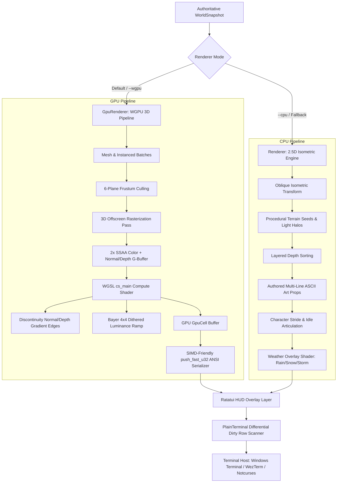

# Comprehensive Architecture & Engine Explainer Guide

> **Target Audience**: External AI agents, systems architects, and contributors onboarding to the `ascii-mmorpg` codebase.
> **Current Version**: Alpha 0.1.0 (`PROTOCOL_VERSION: 2`)

---

## 1. Executive Summary & Game Vision

`ascii-mmorpg` is a high-performance, dark fantasy multiplayer role-playing game built in modern, stable Rust (`edition 2021`). Unlike traditional text-based MUDs or simplistic rogue-likes, `ascii-mmorpg` bridges the gap between retro terminal interfaces and modern real-time 3D graphics engines. 

The game presents an atmospheric, high-fidelity world—featuring ancient mossy ruins, colonnade pillars, towering pine forests with buttressed roots, dynamic torchlit fortresses, and turbulent weather (rain, snow, storm)—rendered entirely through standard ANSI truecolor escape sequences, Unicode box-drawing characters, and CP437 glyphs in standard terminal emulators (Windows Terminal, WezTerm, ConHost, Alacritty, Kitty).

### Key Architectural Highlights
* **Authoritative Client-Server Separation**: Deterministic server simulation running over length-prefixed Postcard binary streams. The server owns positions, ticks, stats, and combat resolution; clients strictly handle prediction, rendering, animation, and presentation.
* **Dual Rendering Pipeline**:
  1. **Hardware-Accelerated WGPU 3D Engine (`client/src/gpu`)**: Full 3D polygon rasterization, GPU-instanced props/particles, 8 dynamic point lights, frustum culling, 2x Super-Sampled Anti-Aliasing (SSAA), and WGSL compute shader discontinuity edge detection ($>170\text{ FPS}$).
  2. **Procedural ANSI CPU Engine (`client/src/renderer.rs`)**: 2.5D oblique isometric rasterizer with ray/depth veils, procedural surface seed texturing, multi-line authored ASCII assets, and post-processing weather passes.
* **Movement-Aware Articulation**: Eliminates the "marching in place" artifact common in retro games; characters feature stationary stance postures with firmly planted boots when idle, and articulate smooth leg swings only during active displacement.
* **Differential Terminal Streaming**: Custom dirty row-level scanner with continuous CRLF burst streaming, preventing Windows ConPTY tearing and achieving smooth, flicker-free 60+ FPS in terminal hosts.
* **Ratatui Dark Fantasy HUD**: TrueColor fractional health gauges, colorized scrolling combat event logs, nearby hostile radar lock, and responsive status headers.

---

## 2. Workspace & Crate Structure

The repository is structured as a Cargo workspace with five specialized crates:

```
ascii-mmorpg/
├── crates/
│   ├── shared/                # Core protocol, network codec, deterministic combat & spatial collisions
│   │   ├── src/collision.rs   # 2D/3D AABB bounding volumes & sliding physics
│   │   ├── src/combat.rs      # Deterministic melee resolution & range calculation
│   │   ├── src/protocol.rs    # Wire commands, snapshots, and entity representations
│   │   └── src/codec.rs       # Length-prefixed Postcard serialization
│   └── libnotcurses-sys/      # Vendored low-level C bindings for Notcurses (optional feature)
├── client/                    # Terminal client, dual renderers, HUD, input loop
│   ├── src/gpu/               # WGPU 3D hardware pipeline (Path C)
│   │   ├── pipeline.rs        # Render & compute pipelines, G-buffers, bind groups
│   │   ├── mesh.rs            # 3D procedural primitives, humanoids, monsters, terrain
│   │   ├── shaders.rs         # WGSL rasterization & ASCII post-process compute shaders
│   │   ├── renderer.rs        # High-level GpuRenderer coordinator & batch processor
│   │   └── obj.rs             # Wavefront OBJ model parser
│   ├── src/renderer.rs        # Procedural CPU ANSI renderer (Path A/B)
│   ├── src/ui.rs              # Ratatui Dark Fantasy HUD overlay
│   ├── src/lib.rs             # PlainTerminal differential blitter & SceneRenderer traits
│   ├── src/main.rs            # Real-time game loop, raw input handler, CLI flags
│   └── src/assets.rs          # Compile-time embedded ASCII asset library
├── server/                    # Authoritative game server, fixed-tick loop, TCP server
├── bot/                       # Headless stress-test client and network simulation bots
├── tools/                     # Content schema validation & offline integrity checkers
├── assets/ascii/              # Multi-frame authored ASCII art (.txt files)
├── content/                   # RON-formatted game data (spells, items, loot tables, zones)
└── docs/                      # Comprehensive technical documentation & Single Source of Truth
```

---

## 3. Rendering Pipeline Architecture

The client implements the `SceneRenderer` trait ([client/src/lib.rs](file:///d:/Personal/codes/Projects/ASCII-Game/ascii-mmorpg/client/src/lib.rs)), enabling hot-swappable rendering pipelines:



### 3.1 The WGPU 3D Hardware Pipeline (`client/src/gpu`)

* **Rasterization Pass**: Renders 3D meshes to an offscreen texture at $2\times$ the character cell resolution ($(\text{width} \times 2, \text{height} \times 2)$).
  * Encodes **Color & Luminance** in `color_tex` (`Rgba8Unorm`).
  * Encodes **Surface Normal $(N_x, N_y, N_z)$ and Linear Depth $(W)$** in `normal_depth_tex` (`Rgba32Float`).
* **Instanced Batching & Culling**:
  * Props (trees, colonnade pillars, ruins) and 180 weather particles are rendered using hardware instancing via 96-byte `InstanceRaw` descriptors (model matrix, color tint, material parameters).
  * A 6-plane CPU camera frustum ([Gribb-Hartmann algorithm](file:///d:/Personal/codes/Projects/ASCII-Game/ascii-mmorpg/client/src/gpu/mesh.rs#L97-L120)) culls non-visible instances before submitting draw calls.
* **Vertex Wind Swaying**: In `vs_main`, foliage vertices (`material_id == 3.0` where $Y > 0.8$) oscillate laterally using sinusoidal time equations, imparting organic wind drift to pine boughs and tree canopies.
* **WGSL Compute Post-Processing (`cs_main`)**:
  * Evaluates 4 sub-pixel quadrant texels per character cell (SSAA Anti-Aliasing).
  * **Edge Detection**: Computes horizontal and vertical normal and depth gradients ($\Delta \text{Normal} + 10 \times \Delta \text{Depth}$). Structural creases and silhouettes are mapped to directional contour glyphs (`_`, `|`, `/`, `\`, `+`).
  * **Luminance Ramp**: Non-edge surfaces evaluate perceived luminance ($0.2126R + 0.7152G + 0.0722B$), modulated by a $4 \times 4$ Bayer dither matrix, mapping smoothly into calibrated character ramps:
    $$\text{Luminance} \to [\text{` `}, \text{`·`}, \text{`:`}, \text{`*`}, \text{`=`}, \text{`o`}, \text{`O`}, \text{`%`}, \text{`#`}, \text{`@`}]$$
  * **Atmospheric Contrast**: Boosts foreground color while injecting dark ambient backing color ($12\%$ luminance tint) for visual depth.

### 3.2 The Procedural CPU Engine (`client/src/renderer.rs`)

* **Oblique Isometric Projection**: World coordinates $(x, y)$ map to screen space via $(X_{\text{center}} + \Delta x + \Delta y / 2, Y_{\text{center}} + \Delta y / 2)$.
* **Lighting Model**: Smooth Euclidean radial falloff from player-carried lanterns and stationary fixtures with dynamic flickers. Unlit fringes fade naturally into deep darkness.
* **Depth Veil**: Far terrain cells undergo simulated aerial perspective, sinking distant hues into low-luminance slate and midnight tones so foreground characters pop.
* **Dedicated Weather Pass**: Top-level shader overlay that composites falling rain streaks, drifting snowflake clusters, or electric storm lightning bolts.

---

## 4. Animation & Articulation Systems

### 4.1 Movement-Aware Stride vs. Stationary Stance
In retro 2.5D and terminal games, characters often march continuously even while idle. `ascii-mmorpg` enforces strict movement awareness across both pipelines:

| Engine | Movement Tracking | Stationary (Idle) Stance | Active Walking Stride |
| :--- | :--- | :--- | :--- |
| **GPU Pipeline** | `GpuRenderer::update_walk_phase` monitors player grid coordinate changes within a 280ms stride window. | `walk_phase = 0.0`. In `add_humanoid`, `leg_swing = 0.0`. Both armored greaves and sabatons rest strictly planted side-by-side ($Y + 0.12, Z + 0.06$). | `walk_phase += 0.35` rad/frame. Alternating forward/backward sinusoidal leg swings and cape sway. |
| **CPU Pipeline** | `Renderer::is_player_walking` tracks position timestamps with interior mutability (`Cell`). | Clamped to **Frame 0**. Both boots `(_____)  (_____)` are symmetrically planted on the ground with zero leg displacement. | Cycles animation frames ($0 \to 1 \to 2 \to 3$), displaying dynamic alternating foot strides. |

---

## 5. Collision & Spatial Physics

Spatial mechanics are governed authoritatively by [crates/shared/src/collision.rs](file:///d:/Personal/codes/Projects/ASCII-Game/ascii-mmorpg/crates/shared/src/collision.rs):

### 5.1 The Ground-Contact Footprint Principle
In isometric and 2.5D graphics, an actor stands on the ground at their feet, while upper foliage, branches, headers, and roofs extend upward into the air. 
* **The Rule**: Collision boundaries strictly represent the **ground-contact footprint** (tree trunks, pillar bases, foundation walls) where feet physically touch the earth.
* **Towering Pine Trees**: Physical collision is strictly a single-tile trunk contact point (e.g. `(-7, -2)`). When a character steps directly in front of a tree (South, $Y + 1$), their feet rest in front of the trunk while their torso and head naturally overlap and occlude the tree via the depth buffer, without triggering premature collision blocking.
* **Smooth Diagonal Sliding**: When walking diagonally (`NE`, `NW`, `SE`, `SW`) against a solid wall or boundary, `resolve_movement` decomposes the vector into cardinal components. If one axis remains open, the actor smoothly slides along the surface rather than coming to an abrupt halt.

---

## 6. Asset Quality & Procedural Representation

Assets are statically compiled into the client executable using `include_str!` ([client/src/assets.rs](file:///d:/Personal/codes/Projects/ASCII-Game/ascii-mmorpg/client/src/assets.rs)), ensuring zero disk I/O latency at runtime. Multi-frame animations are delimited by line-based `---` separators.

### 6.1 Character Models
* **Humanoid Knight** (Player):
  * *CPU Art*: 24 lines of detailed ASCII art featuring golden diadem horns (`▲`), cyan visor slits (`:`), peascod breastplate (`88888888`), crimson cape borders, and steel sabatons.
  * *GPU 3D Mesh*: 42 procedural primitives including greathelm, cheek guards, gorget collar, sculpted faulds, spiked pauldrons, flowing cape, fluted sabatons, gilded heater shield, and broadsword with fuller groove.
* **Skeletal Champion Warrior**:
  * *CPU Art*: Horned spangenhelm, bared ivory teeth, iron tower shield (`[||===||]>`), and executioner's broadsword.
  * *GPU 3D Mesh*: Bleached cranium with ember soul glints, thoracic ribcage, pelvic basin, iron horns, spiked iron pauldrons, and broad executioner blade.
* **Mossling Forest Lurker**:
  * *CPU Art*: Layered moss carapace (`o88888888o`), mandibles, amber predator eyes, and living root talons.
  * *GPU 3D Mesh*: Dorsal spine ridge, quadruped stalker limbs, protruding ivory tusks, and pulsating bioluminescent fungal horns ($[0.45, 0.95, 0.55]$).
* **Herbalist NPC**:
  * *CPU Art*: Woven linen robes, shadow cowl, gentle idle breathing.
  * *GPU 3D Mesh*: Twilight blue robes with gold embroidery, alchemical satchel holding healing and mana flasks, and gnarled elderwood staff with flickering lantern cage.

### 6.2 Environmental Landmark Props
* **Towering Pine Trees**: Sturdy $0.65$-width timber trunk column rising to $Y = 4.80$, buttressed root collar anchoring into the earth, and 4 elevated conical foliage tiers reaching an apex of $7.50$ units.

---

## 7. Performance & Terminal Streaming

### 7.1 Differential Row Scanning (`PlainTerminal`)
Emitting full-screen ANSI frames at 60 FPS generates over $3\text{ MB/s}$ of escape codes, overwhelming terminal emulator parsers and causing severe tearing on Windows ConHost.
* **Our Solution**: [client/src/lib.rs](file:///d:/Personal/codes/Projects/ASCII-Game/ascii-mmorpg/client/src/lib.rs#L156-L184) tracks the previous frame's line array. Only rows containing modified glyphs or colors are transmitted.
* **Contiguous CRLF Optimization**: Sequential dirty lines use standard CRLF sequences, saving cursor jump bytes. Disjoint lines jump directly to row coordinates via `\x1b[{row};1H`.
* **Benchmark Results**:
  * Headless WGPU Compute Pipeline: **171.7 FPS equivalent** ($5.82\text{ ms/frame}$) on NVIDIA GeForce GTX 1650 under Vulkan.
  * Realtime Terminal Streaming: Stable 60 FPS with $<1.2\text{ms}$ draw latency.

---

## 8. Development, Testing & Verification Rules

For any agent modifying this repository, strictly adhere to the following rules:

1. **Deterministic Verification Order**:
   ```bash
   cargo fmt --all -- --check
   cargo test --workspace
   cargo run -p ascii-mmorpg-tools -- content
   cargo clippy --workspace --all-targets -- -D warnings
   ```
2. **Never Let Clients Author State**: All authoritative movement, health changes, and combat damage must occur on the server or via shared deterministic functions in `crates/shared`.
3. **Never Send Rendered Frames Over the Wire**: The network protocol transmits only binary snapshots (`WorldSnapshot`) and commands (`ClientCommand`).
4. **Preserve Differential Streaming**: Never revert `PlainTerminal` to full-buffer `print!` wipes (`\x1b[2J`), as this reintroduces terminal flicker.
5. **Preserve Idle Posture Parity**: When authoring or editing character models, ensure Frame 0 represents a stationary grounded pose so standing characters do not swing their feet.
